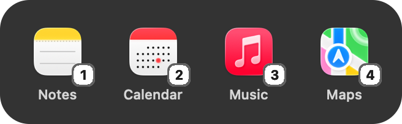

# Hop

A tiny macOS menu bar app for jumping to apps. Press a hotkey, then tap **1–4**.

<p align="center"></p>

Press the hotkey and a small glass bar shows your four apps. Tap a number and you're there.

## Features

- **One hotkey, four apps.** The default hotkey is ⌥Space, and you can change it to anything from the menu bar.
- **Stays out of the way.** The bar never takes focus from the app you're in. It closes on Esc, on a click elsewhere, or after 4 seconds.
- **No permissions needed.** Hop uses standard system hotkeys rather than watching your keyboard, so it doesn't ask for Accessibility access. Keys 1–4 are only captured while the bar is showing.
- **Forgiving.** Number-row or keypad digits both work, as does still holding the hotkey's modifier, or clicking an icon.
- **Optional extras.** Open at login, and hide the menu bar icon entirely.

## Requirements

- macOS 26 (Tahoe) or later
- Xcode or the Xcode Command Line Tools (Swift 6)

## Install

```bash
git clone https://github.com/shocka1357/hop.git
cd hop
./build.sh install
```

This builds `Hop.app`, copies it to `~/Applications`, and launches it. Run `./build.sh` on its own to just build into `build/`.

## Usage

1. Click the grid icon in the menu bar. Hover over **1**, **2**, **3** or **4** and choose an app for each.
2. Press the hotkey from anywhere, then tap a number.

Everything else is in the same menu:

| Menu item | What it does |
| --- | --- |
| **Change Hotkey…** | Press any combination that includes ⌘, ⌥ or ⌃. |
| **Open at Login** | Starts Hop automatically when you log in. |
| **Hide Menu Bar Icon…** | Hop keeps running with no icon. To bring the icon back, open Hop again from Applications or Spotlight. |

## How it works

Hop is under 700 lines of Swift and AppKit, with no dependencies.

- [`HotKeys.swift`](Sources/HotKeys.swift) wraps Carbon's `RegisterEventHotKey`. While the bar is showing, Hop temporarily registers 1–4 and Esc as hotkeys, and releases them as soon as the bar closes.
- [`HUD.swift`](Sources/HUD.swift) is the bar: a non-activating `NSPanel` with an `NSGlassEffectView`.
- [`AppDelegate.swift`](Sources/AppDelegate.swift) runs the menu, launches apps with `NSWorkspace`, and contains the hotkey recorder.
- [`Settings.swift`](Sources/Settings.swift) stores your apps and hotkey in `UserDefaults`.

## License

[MIT](LICENSE)
